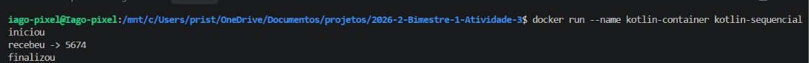
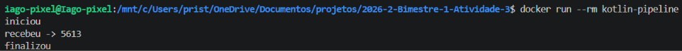
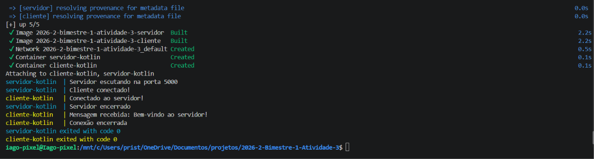

# Relatório sobre implementação de comunicação entre tarefas em Kotlin

## 📍​ Introdução

Este relato faz parte do processo avaliativo da disciplina de **Sistemas Operacionas** no curso superior em **Análise e Desenvolvimento de Sistemas**, ofertado na **Diretoria Acadêmica de Gestão e Tecnologia da Informação** no campus **Natal-Central do Instituto Federal de Educação, Ciência e Tecnologia** do **Rio Grande do Norte**.

A tarefa tem como objetivo principal relatar as implementações de comunicação entre tarefas na linguagem Kotlin.

👥​ O grupo de trabalho foi formado por: **Ana Letícia Vidal de Oliveira, Iago Vinícius Souza de Sales e Valentine Varela**.

## 🎯​ Comunicação entre tarefas em Kotlin

### Informações gerais

Em Kotlin, a comunicação entre tarefas (IPC) fundamenta-se na troca de mensagens em vez da manipulação direta de memória compartilhada. Por meio de **Dutos de mensagem**: O Kotlin utiliza Channel como uma fila ou pipe de dados. **Sincronização não bloqueante**: As operações de envio (send) e recepção (receive) suspendem temporariamente a execução da corrotina sem travar a thread do sistema operacional e **Fronteiras de processo**: Enquanto a comunicação inter-threads/corrotinas ocorre na mesma JVM via canais em memória.


#### 📚​ Objetivo da comunicação entre tarefas e o uso do Docker

A comunicação entre tarefas tem como objetivo permitir que diferentes fluxos de execução, como tarefas ou corrotinas, troquem informações e coordenem suas atividades de forma eficiente durante a execução do programa. Para garantir que essa arquitetura concorrente e o código em Kotlin funcionem com total reprodutibilidade, o Docker é utilizado para criar um ambiente de desenvolvimento isolado e padronizado. Ele permite pré-configurar o ecossistema Kotlin, a JVM (Java Virtual Machine) e todas as dependências do projeto, assegurando um comportamento idêntico do código independentemente da máquina ou sistema operacional utilizado. Além disso, o uso de contêineres simplifica os processos de instalação, configuração e execução, eliminando conflitos de versões de bibliotecas e ferramentas do ambiente de execução.

#### ⚙️​ Configuração do Dockerfile

- Usa imagem eclipse-temurin:17-jdk
- Pasta base: /app
- Atualiza pacotes e configura o compilador Kotlin
- Pega o arquivo e compila em programa.jar
- Começa uma nova imagem, sem o compilador Kotlin
- Redefine /app e pega o programa.jar
- Executa o programa.jar

                 PRIMEIRA ETAPA
              ┌──────────────────┐
              │ JDK 17           │
              │                  │
              │ Kotlin Compiler  │
              │       ↓          │
              │ [nome].kt        │
              │       ↓          │
              │ programa.jar     │
              └────────┬─────────┘
                       │
                       │ copia apenas o .jar
                       ▼
                 SEGUNDA ETAPA
              ┌──────────────────┐
              │ JRE 17           │
              │                  │
              │ programa.jar     │
              │       ↓          │
              │ java -jar        │
              └──────────────────┘

#### 🐋​ Configurações utulizadas no Dockerfile

```Dockerfile
FROM eclipse-temurin:17-jdk AS builder

WORKDIR /app

RUN apt-get update && \
    apt-get install -y wget unzip && \
    wget https://github.com/JetBrains/kotlin/releases/download/v1.9.23/kotlin-compiler-1.9.23.zip && \
    unzip kotlin-compiler-1.9.23.zip -d /opt && \
    rm kotlin-compiler-1.9.23.zip

ENV PATH="/opt/kotlinc/bin:${PATH}"

COPY src/kotlin/sequencial.kt .

RUN kotlinc sequencial.kt -include-runtime -d programa.jar

FROM eclipse-temurin:17-jre

WORKDIR /app

COPY --from=builder /app/programa.jar .

CMD ["java", "-jar", "programa.jar"]
```

### 📋​ Sem uso de tarefas
Nesta abordagem básica, o programa é executado de forma estritamente sequencial dentro de uma única thread, servindo como baseline para comparar o comportamento da aplicação antes da introdução de concorrência ou mecanismos de comunicação entre tarefas.

#### 🔎​ O código

- Importação e Geração Pseudoaleatória: O código utiliza a instrução import kotlin.random.Random para importar a classe nativa da biblioteca padrão do Kotlin, responsável por gerar sequências de números inteiros pseudoaleatórios.

```kotlin
import kotlin.random.Random
```
  
- Mapeamento do Produtor (produzirDados): A função produzirDados() possui a criação da lista com: List<Int>, indicando o retorno de uma coleção imutável de inteiros. Dentro de seu escopo, utiliza-se um construtor da coleção para instanciar 100 elementos. A expressão Random.nextInt(0, 111) é executada para cada posição da lista, gerando inteiros no intervalo [0, 110] (onde o limite superior 111 é exclusivo e não entra na lista produzida).

```Kotlin
fun produzirDados(): List<Int> {
    val dados = List(100) {
        Random.nextInt(0, 111)
    }
```
  
- Mapeamento do Consumidor (consumirDados): A função consumirDados(dados: List<Int>) recebe a estrutura de dados preenchida como parâmetro. O processamento ocorre via função de extensão .sum(), que percorre linearmente a coleção, computando o somatório acumulado dos valores e emitindo o resultado via stdout.

```Kotlin
fun consumirDados(dados: List<Int>) {
    val resultado = dados.sum()
    println("recebeu -> $resultado")
```

- Orquestração e Ponto de Entrada (principal e main): A função principal() coordena o fluxo de execução síncrono. Por não utilizar rotinas assíncronas ou corrotinas, há um acoplamento temporal direto: a etapa de consumo fica completamente bloqueada até que a produção dos 100 elementos seja totalmente concluída e alocada em memória. A função main() atua como o ponto de entrada (entry point) padrão da aplicação na JVM.


```Kotlin
fun principal() {
    println("iniciou")

    val dados = produzirDados()
    consumirDados(dados)

    println("finalizou")
}

fun main() {
    principal()
}
```

#### O código completo

```kotlin
import kotlin.random.Random

fun produzirDados(): List<Int> {
    val dados = List(100) {
        Random.nextInt(0, 111)
    }

    return dados
}

fun consumirDados(dados: List<Int>) {
    val resultado = dados.sum()
    println("recebeu -> $resultado")
}

fun principal() {
    println("iniciou")

    val dados = produzirDados()
    consumirDados(dados)

    println("finalizou")
}

fun main() {
    principal()
}
```

#### Execução

A execução do projeto foi padronizada e automatizada por meio do Docker, garantindo um ambiente de execução isolado, reprodutível e livre de divergências de ambiente. A partir de um Dockerfile

Bash
```Bash
# Construção da imagem Docker a partir do Dockerfile
docker build -t kotlin-sequencial .

# Execução do contêiner em ambiente isolado
docker run --name kotlin-container kotlin-sequencial
```
#### Exemplo de saída do terminal:



#### Problemas enfrentados

Houve um problema enfretado que o Docker não encontrou a imagem zenika/kotlin:1.9-jdk17, que é uma imagem que já vem com o kotlin. Foi então necessário usar uma imagem oficial do Java e configurar nela o compilador do kotlin para poder executar o código.

### ​📚​ Comunicação entre tarefas com linhas de execução no mesmo processo


##### Ex-1: Abordagem Sequencial e Síncrona

- Essa primeira abordagem demonstra o padrão de execução síncrono tradicional, no qual o produtor e o consumidor operam sequencialmente na mesma thread (main thread), servindo como base antes da introdução de concorrência.

- Importação da Biblioteca: A instrução import kotlin.random.Random importa a classe nativa da biblioteca padrão do Kotlin responsável pela geração de sequências de números inteiros pseudoaleatórios.

- Geração de Dados (produzirDados): A função possui a assinatura fun produzirDados(): List<Int>, explicitando o retorno de uma coleção imutável de inteiros. O construtor List(100) aloca 100 elementos, onde a instrução Random.nextInt(0, 111) é invocada a cada iteração para gerar inteiros no intervalo de 0 a 110 (com o limite superior 111 exclusivo).

- Consumo e Processamento (consumirDados): A função recebe a lista preenchida como parâmetro e aplica a função de extensão .sum(), executando o somatório linear de todos os elementos e emitindo o resultado no terminal.

- Organização (principal e main): A função principal() gerencia o fluxo de execução síncrono: imprime o início da execução, aciona a produção, repassa o resultado diretamente para o consumo e finaliza o ciclo. A função main() atua como o ponto de entrada da aplicação na JVM.

```kotlin
import kotlin.random.Random

fun produzirDados(): List<Int> {
    val dados = List(100) {
        Random.nextInt(0, 111)
    }

    return dados
}

fun consumirDados(dados: List<Int>) {
    val resultado = dados.sum()
    println("recebeu -> $resultado")
}

fun principal() {
    println("iniciou")

    val dados = produzirDados()
    consumirDados(dados)

    println("finalizou")
}

fun main() {
    principal()
}
```

##### Saida Ex-1:


#### Ex-2: Abordagem Concorrente com Corrotinas e Estado Compartilhado

- A segunda abordagem introduz concorrência por meio de corrotinas da biblioteca kotlinx.coroutines. A comunicação entre as tarefas ocorre via memória compartilhada, utilizando uma variável alocada no mesmo espaço de endereçamento do processo.

- Importação das Dependências: A instrução import kotlinx.coroutines.* carrega as abstrações de concorrência assíncrona do Kotlin, enquanto import kotlin.random.Random fornece o gerador de números aleatórios.

- Memória Compartilhada (dados): É declarada a variável global var dados = mutableListOf<Int>(), atuando como a estrutura de dados compartilhada entre os fluxos de execução do produtor e do consumidor.

- Funções de Produção e Consumo: A função produzirDados() gera a lista de 100 inteiros e substitui o conteúdo da variável compartilhada em memória. Em seguida, consumirDados() acessa esse mesmo endereço de memória, lê a estrutura, calcula o somatório via dados.sum() e exibe os dados processados no terminal.

- Gerenciamento do Ciclo de Vida (main e runBlocking): A função main utiliza o construtor de corrotina runBlocking, que estabelece uma ponte entre o mundo síncrono e o assíncrono, bloqueando a thread principal até que todas as corrotinas filhas dentro do seu escopo concluam o processamento.
 
##### Ex-2 código:

```kotlin
import kotlinx.coroutines.*
import kotlin.random.Random

var dados = mutableListOf<Int>()

fun produzirDados() {
    println("# produzir - iniciado")
    dados = List(100) { Random.nextInt(0, 111) }.toMutableList()
    println("# produzir $dados")
    println("# produzir - terminado")
}

fun consumirDados() {
    println("### consumir - iniciado")
    println("### dados -> $dados")
    val resultado = dados.sum()
    println("### resultado -> $resultado")
    println("### consumir - terminado")
}

fun main() = runBlocking {
    println("iniciou")

    val jobProdutor = launch {
        produzirDados()
    }

    jobProdutor.join()

    val jobConsumidor = launch {
        consumirDados()
    }
    jobConsumidor.join()

    println("finalizou")
}
```

##### Saida Ex-2:


#### Execução:

1. Inicialização do Contexto Concorrente: Ao executar a aplicação, a mensagem "iniciou" é exibida e o builder runBlocking é ativado. Ele assume a gestão da thread principal, impedindo que a aplicação seja encerrada prematuramente antes da conclusão das tarefas assíncronas.

2. Disparo do Produtor: A função launch instancia a corrotina do produtor (jobProdutor), executando produzirDados() de forma concorrente para preencher a variável dados em memória com 100 inteiros aleatórios (no intervalo de 0 a 110).

3. Barreira de Sincronização (join): A instrução jobProdutor.join() suspende a corrotina principal até que o produtor conclua sua tarefa 100%. Esse mecanismo funciona como uma barreira de sincronização essencial: ele previne race conditions (condições de corrida), garantindo que a corrotina do consumidor só leia a lista quando o preenchimento estiver totalmente finalizado.

4. Disparo e Processamento do Consumidor: Com os dados garantidamente alocados, a corrotina do consumidor (jobConsumidor) é disparada via launch. Ela acessa a memória compartilhada, executa a redução dos valores com .sum() e imprime o resultado final.

5. Finalização Controlada: A chamada jobConsumidor.join() aguarda a conclusão da tarefa de consumo. Após o término, o programa imprime "finalizou" e o runBlocking liberta a thread principal, encerrando o processo de forma segura.

### 📤 Comunicação entre tarefas em processos diferentes no mesmo computador 📥​

Diferente do compartilhamento de memória entre corrotinas em um mesmo processo, para trocar dados nesse exemplo, utiliza-se o mecanismo de pipes, onde a saída padrão (stdout) de um processo é redirecionada diretamente para a entrada padrão (stdin) de outro. O código do pipeline foi desenvolvido para executar dois programas Kotlin, produtor.kt e consumidor.kt, de forma sequencial e integrada. Primeiro, os arquivos são compilados em arquivos executaives .jar por meio do compilador Kotlin no Dockerfile. Em seguida, o comando java -jar produtor.jar | java -jar consumidor.jar utiliza o operador pipe (|) para encaminhar a saída padrão do produtor diretamente para a entrada padrão do consumidor.

##### Produtor

```kotlin
import kotlin.random.Random //Importa o gerador de números pseudoaleatórios da biblioteca padrão do Kotlin.

fun produzirDados(): List<Int> {
    val dados = List(100) {
        Random.nextInt(0, 111)
    }

    return dados
}

//Cria e retorna uma lista imutável com 100 inteiros gerados aleatoriamente no intervalo de 0 a 110.

fun principal() {
    val dados = produzirDados()
    println(dados.joinToString(separator = ","))
}

fun main() {
    principal()
}
//Executa a função de produção e converte a lista de inteiros em uma única string formatada, separando os valores por vírgula. Por fim, A chamada println(...) envia essa string para o fluxo de saída padrão.
```

##### Consumidor
```kotlin
import kotlin.random.Random
fun consumirDados(dados: List<Int>) {
    val resultado = dados.sum()
    println("recebeu -> $resultado")
}
//Recebe a lista de inteiros, calcula a soma de todos os seus elementos via .sum() e imprime o resultado na tela.

fun principal() {
    println("iniciou") //Sinaliza o início da execução do processo consumidor.

    val dados_em_texto = readln() //Bloqueia a execução do processo até que uma linha inteira de dados seja lida a partir da entrada padrão.
    val dados: List<Int> = dados_em_texto
        .split(",")
        .map { it.toInt() }
        //Processa a string recebida, dividindo-a nas vírgulas e convertendo cada elemento textual de volta para o tipo inteiro.

    consumirDados(dados) //Repassa a lista reconstruída para o cálculo do somatório.

    println("finalizou") //Sinaliza o término do processamento.
}

fun main() {
    principal()
}
```

#### Bash
```Bash
# 1. Compilação do produtor e do consumidor gerando os arquivos .jar
kotlinc produtor.kt -include-runtime -d produtor.jar
kotlinc consumidor.kt -include-runtime -d consumidor.jar

# 2. Execução encadeada via operador de Pipe (|)
java -jar produtor.jar | java -jar consumidor.jar

# 3. Execução do contêiner configurado com o pipeline
docker run --rm kotlin-pipeline
```

##### Exemplo de saida:



### 🖥️​ Comunicação entre tarefas em processos diferentes em computadores diferentes ​💻​

Até agora, vimos nossas tarefas rodando no mesmo processo, onde threads ou corrotinas compartilham a mesma memória RAM. Mas e se a função produzirDados rodar em um programa e a consumirDados rodar em outro completamente separado? Iremos usar um exemplo diferente para exemplificar essa lógica.

#### Sobre o código

A comunicação interprocessos (IPC) em rede baseia-se na troca de mensagens entre aplicações isoladas utilizando a pilha de protocolos TCP/IP. Nesta abordagem, um programa atua como Servidor, mantendo uma porta de rede aberta para escutar solicitações, enquanto o Cliente estabelece uma conexão ativa para a troca de dados.

Para garantir o isolamento completo e simular um ambiente distribuído real, cada aplicação é executada em um contêiner Docker próprio. A resolução de nomes entre as aplicações é gerenciada pela infraestrutura de rede virtualizada do Docker Compose.


#### Servidor básico

O servidor configura um socket de escuta TCP para aguardar a conexão do cliente, envia uma mensagem de boas-vindas codificada em bytes e encerra a conexão.

```kotlin
import java.net.ServerSocket
import java.net.InetAddress

fun main() {
    val servidor = ServerSocket(
        5000,
        1,
        InetAddress.getByName("0.0.0.0")
    )

    println("Servidor escutando na porta 5000")

    val conexao = servidor.accept()
    println("Cliente conectado!")

    val mensagem = "Bem-vindo ao servidor!"
    conexao.getOutputStream().write(
        mensagem.toByteArray(Charsets.UTF_8)
    )

    conexao.close()
    servidor.close()

    println("Servidor encerrado")
}
```

##### Cliente básico

O cliente conecta-se ao servidor utilizando o nome do serviço configurado na rede do Docker, aloca um buffer na memória para ler o fluxo de dados recebido e exibe a mensagem no console.

```kotlin
import java.net.Socket

fun main() {
    val cliente = Socket("servidor", 5000)

    println("Conectado ao servidor!")

    val buffer = ByteArray(1024)
    val quantidade = cliente.getInputStream().read(buffer)

    if (quantidade != -1) {
        val mensagem = String(
            buffer, 0, quantidade, Charsets.UTF_8
        )
        println("Mensagem recebida: $mensagem")
    }

    cliente.close()
    println("Conexão encerrada")
}
```

#### Exemplo de saída:



### Execução

A compilação e a execução de ambos os programas ocorrem dentro de uma rede interna virtual isolada (bridge network) fornecida pelo Docker Compose.

### Problemas enfrentados

- Ao implementar a comunicação utilizando Redis, os dados enviados pelo Processo A não foram recebidos corretamente pelo Processo B. Em vez dos 100 números, o Processo B recebeu apenas um valor, mostrando que a comunicação com o protocolo do Redis estava sendo feita de forma incorreta.

- Também tivemos problemas de sincronização, pois o Processo B poderia tentar buscar os dados antes que o Processo A tivesse enviado.

- Para simplificar o projeto e evitar esses problemas, substituímos o Redis por uma comunicação direta utilizando TCP Socket. Assim, o Processo B fica aguardando uma conexão e o Processo A envia diretamente os dados para ele.

## Considerações finais

O grupo concluiu com êxito a implementação e a execução de todas as atividades propostas, demonstrando na prática a viabilidade e a eficiência do ecossistema Kotlin na construção de sistemas concorrentes e distribuídos.

O principal ganho acadêmico e técnico concentrou-se no domínio de Corrotinas (Coroutines) para a manipulação assíncrona de tarefas, aliado à consolidação de boas práticas em Docker. Destaca-se a adoção da técnica de Multi-stage Build no Dockerfile, uma abordagem arquitetural crucial que permitiu separar com rigor o estágio de compilação dos binários Kotlin do ambiente enxuto de execução final (runtime), otimizando o tamanho da imagem e a segurança da aplicação.

Para os alunos que desenvolverão este projeto em etapas subsequentes, o grupo compartilha duas recomendações fundamentais para o sucesso da execução:

1. Estabeleçam a Infraestrutura de Contêineres no Dia Um:
Configurem e validem o ambiente Docker logo no início do desenvolvimento. Garantir a padronização do ambiente de execução nos primeiros dias elimina incompatibilidades de versão da JVM/Kotlin entre diferentes sistemas operacionais e evita o clássico problema de "funciona na minha máquina".

2. Compreendam a Mudança de Paradigma das Corrotinas:
Estudem profundamente a documentação oficial de Kotlin Coroutines antes de implementar a lógica concorrente. A sincronização baseada em suspensão não-bloqueante e troca de mensagens (Channels/Flows) difere conceitualmente do modelo tradicional de Threads e travas manuais (Mutexes). Entender essa transição de modelo mental é a chave para escrever um código limpo, seguro e performático.
