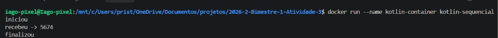
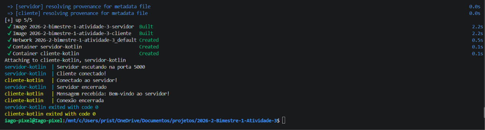

# Relatório sobre implementação de comunicação entre tarefas em Kotlin

## Introdução

Este relato faz parte do processo avaliativo da disciplina de sistemas operacionas no curso superior em análise e desenvolvimento de sistemas, ofertado na Diretoria acadêmica de gestão e tecnologia da informação no campus natal-central do instituto federal de educação, ciência e tecnologia do rio grande do norte.

Tem como objetivo principal relatar as implementações de comunicação entre tarefas na linguagem Kotlin.

O grupo de trabalho foi formado por Ana Letícia Vidal de Oliveira, Iago Vinícius Souza de Sales e Valentine Varela.

## Comunicação entre tarefas em Kotlin

### Informações gerais

#### Objetivo da comunicação entre tarefas

> O objetivo da comunicação entre tarefas é permitir que diferentes tarefas ou coroutines troquem informações e coordenem suas atividades durante a execução de um programa.

#### Por que Docker?

> O Docker é utilizado para criar um ambiente padronizado para executar o projeto. Nesse trabalho, ele permite configurar previamente o Kotlin e suas dependências, garantindo que o código seja executado da mesma forma, independentemente do computador utilizado.

> Além disso, o Docker facilita a instalação, configuração e execução do projeto, evitando problemas relacionados a diferentes versões do Kotlin, Java ou bibliotecas.

#### Configuração do Dockerfile

- Usa imagem eclipse-temurin:17-jdk
- Pasta base: /app
- Atualiza pacotes e configura o compilador Kotlin
- Pega o arquivo e compila em programa.jar
- Começa uma nova imagem, sem o compilador Kotlin
- Redefine /app e pega o programa.jar
- Executa o programa.jar

                 PRIMEIRA ETAPA
              ┌──────────────────┐
              │ JDK 17           │
              │                  │
              │ Kotlin Compiler  │
              │       ↓          │
              │ [nome].kt        │
              │       ↓          │
              │ programa.jar     │
              └────────┬─────────┘
                       │
                       │ copia apenas o .jar
                       ▼
                 SEGUNDA ETAPA
              ┌──────────────────┐
              │ JRE 17           │
              │                  │
              │ programa.jar     │
              │       ↓          │
              │ java -jar        │
              └──────────────────┘

```Dockerfile
FROM eclipse-temurin:17-jdk AS builder

WORKDIR /app

RUN apt-get update && \
    apt-get install -y wget unzip && \
    wget https://github.com/JetBrains/kotlin/releases/download/v1.9.23/kotlin-compiler-1.9.23.zip && \
    unzip kotlin-compiler-1.9.23.zip -d /opt && \
    rm kotlin-compiler-1.9.23.zip

ENV PATH="/opt/kotlinc/bin:${PATH}"

COPY src/kotlin/sequencial.kt .

RUN kotlinc sequencial.kt -include-runtime -d programa.jar

FROM eclipse-temurin:17-jre

WORKDIR /app

COPY --from=builder /app/programa.jar .

CMD ["java", "-jar", "programa.jar"]
```

### Sem uso de tarefas

#### O código

> A primeira linha desse código permite que o program faço o importe de uma classe do pacote nativo que gera números aleatórios.

> Após isso é criada a função "produziDados" que indica o retorno de uma lista de números inteiros.

```kotlin
fun produzirDados(): List<Int> {
```

> Temos, então, o bloco dentro das chaves é executado 100 vezes (uma para cada elemento da lista). A cada repetição, Random.nextInt(0, 111) gera um inteiro aleatório no intervalo de 0 a 110 (o limite 111 é exclusivo).

> Após isso, temos a função "consumirDados" que realiza uma operação de soma de todos os valores recebidos na lista e gera o resultado que é colocado no terminal.

```kotlin
val resultado = dados.sum()
```

> Logo após temos a principal função definida como "principal", essa função realiza a chamada da produção de dados e atirbui a lista a variavel "dados" após isso faz a chamada para afunção seguinte que realiza a operação já mencionada. Ela coloca no terminal o inicio e o fim do processo.

```kotlin
import kotlin.random.Random

fun produzirDados(): List<Int> {
    val dados = List(100) {
        Random.nextInt(0, 111)
    }

    return dados
}

fun consumirDados(dados: List<Int>) {
    val resultado = dados.sum()
    println("recebeu -> $resultado")
}

fun principal() {
    println("iniciou")

    val dados = produzirDados()
    consumirDados(dados)

    println("finalizou")
}

fun main() {
    principal()
}
```

#### Execução

> Para executar o código foi preciso configurar o Dockerfile, buildar a imagem e então executar um container. As configurações do Dockerfile deixam todo o processo automatizado.



#### Problemas enfrentados

> Unico problema enfretado foi que o Docker não encontrou a imagem zenika/kotlin:1.9-jdk17, que é uma imagem que já vem com o kotlin. Foi então necessário usar uma imagem oficial do Java e configurar nela o compilador do kotlin.

### Comunicação entre tarefas com linhas de execução no mesmo processo

#### O código

##### Ex-1:
> A primeira linha desse código permite que o program faço o importe de uma classe do pacote nativo que gera números aleatórios.
> Após isso é criada a função "produzirDados" que indica o retorno de uma lista de números inteiros.

```kotlin
fun produzirDados(): List<Int> {
```

> Temos, então, o bloco dentro das chaves é executado 100 vezes (uma para cada elemento da lista). A cada repetição, Random.nextInt(0, 111) gera um inteiro aleatório no intervalo de 0 a 110 (o limite 111 é exclusivo).
> Após isso, temos a função "consumirDados" que realiza uma operação de soma de todos os valores recebidos na lista e gera o resultado.

```kotlin
val resultado = dados.sum()
```

> Logo após temos a principal função definida como "principal", essa função realiza a chamada da produção de dados e atirbui a lista a variavel "dados" após isso faz a chamada para afunçaõ seguinte que a realiza a operação já mencionada.


##### Ex-2:
> A linha 1 e 2 são importes para ferramentas que vamos usar no código, a primeira serve para as corotinas em kotlin e a segunda é uma classe de geração de número aleatório que usaremos na lista que iremos criar:

```kotlin
import kotlin.random.Random
```

> Após isso é criada a variável que irá guardar a lista de números, em seguida definimos uma função para que os valores da lista gerados sejam armazenados na variavel, com respectivos "printl" para indicar o processo sendo realizado.
> Após isso, criamos outra função "consumirDados" que iremos usar para realizar operações, no caso do exemplo a soma de todos os números da lista que foi criada e armazenada.

```kotlin
resultado = dados.sum()
```

> Por fim, há a função principal "main" que usa o runBlocking. O runBlocking bloqueia a thread principal até que todas as corrotinas criadas dentro do seu bloco terminem de executar. Dentro dele temos as execuções e chamadas das funções anteriores também.

 
##### Ex-1 código:

```kotlin
import kotlin.random.Random

fun produzirDados(): List<Int> {
    val dados = List(100) {
        Random.nextInt(0, 111)
    }

    return dados
}

fun consumirDados(dados: List<Int>) {
    val resultado = dados.sum()
    println("recebeu -> $resultado")
}

fun principal() {
    println("iniciou")

    val dados = produzirDados()
    consumirDados(dados)

    println("finalizou")
}

fun main() {
    principal()
}
```

##### Ex-2 código:

```kotlin
import kotlinx.coroutines.*
import kotlin.random.Random

var dados = mutableListOf<Int>()

fun produzirDados() {
    println("# produzir - iniciado")
    dados = List(100) { Random.nextInt(0, 111) }.toMutableList()
    println("# produzir $dados")
    println("# produzir - terminado")
}

fun consumirDados() {
    println("### consumir - iniciado")
    println("### dados -> $dados")
    val resultado = dados.sum()
    println("### resultado -> $resultado")
    println("### consumir - terminado")
}

fun main() = runBlocking {
    println("iniciou")

    val jobProdutor = launch {
        produzirDados()
    }

    jobProdutor.join()

    val jobConsumidor = launch {
        consumirDados()
    }
    jobConsumidor.join()

    println("finalizou")
}
```

Execução:
> O programa começa a rodar, imprime "iniciou" na tela e ativa o runBlocking. O runBlocking funciona como o Gerente mantendo as portas abertas: o programa não encerra enquanto as tarefas internas não terminarem.

> O Produtor é acionado para criar a lista. Ele sorteia 100 números inteiros aleatórios (entre 0 e 110) e guarda essa lista na memória.

> O "join" faz uma pausa e obriga o Consumidor a esperar até que o Produtor termine 100% de preencher a lista. Essa ordem é crucial para impedir que o Consumidor tente ler uma lista ainda vazia.

> Com a lista devidamente preenchida, o Consumidor entra em ação. Ele lê os 100 números, faz o somatório de todos os valores (.sum()) e imprime o resultado formatado no console.

> O programa confirma que o Consumidor também terminou o seu trabalho, imprime "finalizou" na tela e fecha o programa com segurança.


##### Saida Ex-1:


##### Saida Ex-2:


> Até agora, vimos nossas tarefas rodando no mesmo processo, onde threads ou corrotinas compartilham a mesma memória RAM. Mas e se a função produzirDados rodar em um programa e a consumirDados rodar em outro completamente separado?

> Para entregar nossa lista de 100 números, precisamos usar o próprio Sistema Operacional para intermediar essa mensagem. Podemos fazer isso de algumas formas, o que citaremos é socket:

    Usando Sockets Locais, transmitindo os dados via rede interna do computador;

> O ponto central para guardar é esse: enquanto em threads a gente apenas lê uma variável compartilhada na memória, entre processos nós precisamos serializar e transmitir essa informação.

### Comunicação entre tarefas em processos diferentes no mesmo computador

A linguagem Kotlin, por herdar o ecossistema robusto do Java, realiza a comunicação entre processos diferentes no mesmo computador por meio de um mecanismo chamado ProcessBuilder.
​No código a seguir, utilizamos os mesmos exemplos da atividade para demonstrar o que seria análogo a essa lógica. O ponto de entrada main utiliza o parâmetro args para decidir qual papel vai desempenhar: quando o programa é iniciado normalmente, sem argumentos, ele assume o papel de processo principal. Quando é iniciado com o argumento produtor, ele assume o papel de subprocesso isolado.
​Durante a execução do produtor, utiliza-se o ProcessBuilder para abrir uma nova instância da aplicação passando a flag correspondente. Esse subprocesso gera uma lista de dados e imprime o conteúdo em sua saída padrão. O processo principal intercepta a saída do subprocesso através de um fluxo de leitura que funciona exatamente como um pipe, aguarda o término do processo, captura a string com os números gerados, converte-os de volta para uma lista de inteiros, calcula a soma e exibe o resultado final.

fun processoProdutor() {
    val dados = List(100) {
        Random.nextInt(0, 111)
    }
    // Imprime apenas os números separados por vírgula para o pipe ler limpo
    print(dados.joinToString(","))
}

fun processoConsumidor(dadosStr: String) {
    if (dadosStr.isBlank()) return
    val dados = dadosStr.split(",").map { it.toInt() }
    val resultado = dados.sum()
    println("recebeu -> $resultado")
}

fun main(args: Array<String>) {
    if (args.isNotEmpty() && args[0] == "produtor") {
        processoProdutor()
        return
    }

    println("iniciou")

    // Configura a chamada do subprocesso em Kotlin/JVM
    val javaBin = "${System.getProperty("java.home")}/bin/java"
    val classpath = System.getProperty("java.class.path")
    val className = {}::class.java.enclosingClass.name

    // Dispara o subprocesso passando o argumento "produtor"
    val process = ProcessBuilder(javaBin, "-cp", classpath, className, "produtor")
        .start()

    // Lê os dados que vieram pelo pipe do subprocesso
    val dadosRecebidos = process.inputStream.bufferedReader().use { it.readText() }
    process.waitFor()

    // Passa os dados recebidos via pipe para o consumidor
    processoConsumidor(dadosRecebidos)

    println("finalizou")
}


> mostrar as saídas do terminal


FIXME
> se houve problema na execução, enumerar os problemas e suas respectivas soluções

### Comunicação entre tarefas em processos diferentes em computadores diferentes

#### O código

> O projeto demonstra a comunicação entre dois processos independentes utilizando Kotlin, Docker e TCP Socket.

> O Processo A é responsável por gerar uma lista com 100 números aleatórios. Depois, ele cria um Socket e se conecta ao Processo B através da porta 5000. A lista é convertida para texto e enviada pela conexão TCP.

> O Processo B funciona como servidor. Ele utiliza ServerSocket(5000) para ficar aguardando uma conexão. Quando o Processo A se conecta, B recebe os dados, transforma a mensagem novamente em uma lista de números e calcula a soma.

> O Docker Compose cria e conecta os dois containers em uma rede interna. Dessa forma, o Processo A consegue encontrar o Processo B pelo nome processo-b.

> Assim, o projeto mostra como dois processos separados podem trocar informações pela rede sem compartilhar diretamente a memória, simulando a comunicação entre dois computadores.

##### Processo-a

```kotlin
import java.net.Socket
import kotlin.random.Random

fun produzirDados(): List<Int> {
    return List(100) {
        Random.nextInt(0, 111)
    }
}

fun main() {

    val dados = produzirDados()

    println("Processo A produziu:")
    println(dados)

    val socket = Socket("processo-b", 5000)

    println("Processo A: conectado ao Processo B!")

    val mensagem = dados.joinToString(",")

    val writer = socket
        .getOutputStream()
        .bufferedWriter()

    writer.write(mensagem)
    writer.newLine()
    writer.flush()

    println("Processo A: dados enviados!")

    socket.close()
}
```

#### processo-b
```kotlin
import java.net.ServerSocket

fun main() {
    val server = ServerSocket(5000)

    println("Processo B: aguardando conexão do Processo A...")

    val socket = server.accept()

    println("Processo B: Processo A conectado!")

    val mensagem = socket
        .getInputStream()
        .bufferedReader()
        .readLine()

    val dados = mensagem
        .split(",")
        .map { it.toInt() }

    println("Processo B recebeu:")
    println(dados)

    val soma = dados.sum()

    println("Soma dos dados: $soma")

    socket.close()
    server.close()
}
```

### Execução

> A execução do projeto aconteceu através do Docker Compose, que foi responsável por criar e executar os dois processos em containers separados. O Docker executou os dois programas separadamente, enquanto o TCP Socket foi responsável por fazer a comunicação entre eles.



### Problemas enfrentados

> Ao implementar a comunicação utilizando Redis, os dados enviados pelo Processo A não foram recebidos corretamente pelo Processo B. Em vez dos 100 números, o Processo B recebeu apenas um valor, mostrando que a comunicação com o protocolo do Redis estava sendo feita de forma incorreta.

> Também tivemos problemas de sincronização, pois o Processo B poderia tentar buscar os dados antes que o Processo A tivesse enviado.

> Para simplificar o projeto e evitar esses problemas, substituímos o Redis por uma comunicação direta utilizando TCP Socket. Assim, o Processo B fica aguardando uma conexão e o Processo A envia diretamente os dados para ele.

## Considerações finais

> O arquivo `consumidor.kt` utiliza Coroutines (`kotlinx.coroutines`), que são alternativas mais leves às threads, para realizar a comunicação concorrente.

> Uma lista global mutável chamada `dados` é compartilhada. A função `produzirDados` preenche essa lista, e `consumirDados` realiza a soma.

> Na função principal, usamos `runBlocking` e `launch` para disparar as tarefas. O comando `jobProdutor.join()` obriga o consumidor a esperar a produção terminar, evitando erros de leitura antes do tempo.

```kotlin
import kotlinx.coroutines.*
import kotlin.random.Random

var dados = mutableListOf<Int>()

fun produzirDados() {
    println("# produzir - iniciado")
    dados = List(100) { Random.nextInt(0, 111) }.toMutableList()
    println("# produzir $dados")
    println("# produzir - terminado")
}
fun consumirDados() {
    println("### consumir - iniciado")
    println("### dados -> $dados")
    val resultado = dados.sum()
    println("### resultado -> $resultado")
    println("### consumir - terminado")
}

fun main() = runBlocking {
    println("iniciou")

    val jobProdutor = launch {
        produzirDados()
    }

    jobProdutor.join()

    val jobConsumidor = launch {
        consumirDados()
    }
    jobConsumidor.join()

    println("finalizou")
}
```

#### Execução

> Para a execução, o Servidor é iniciado primeiro. Assim que o Cliente se conecta via IP e porta, a transferência de dados ocorre com sucesso.

#### Problemas enfrentados
> O principal entrave foi o isolamento de rede do Docker, que bloqueia conexões externas por padrão. A solução é usar a flag -p 12345:12345 ao rodar o container para mapear a porta e liberar o acesso.

## Considerações finais
> O grupo conseguiu implementar e executar com sucesso todas as atividades, adaptando a lógica de concorrência para as ferramentas nativas do Kotlin.

> O maior aprendizado foi entender o uso de Coroutines e consolidar os conhecimentos em Docker, destacando a técnica de multi-stage build que separou a compilação da execução do projeto.

> Para próximos alunos, recomendamos configurar o Docker logo no início para evitar problemas de versão entre as máquinas, e ler atentamente a documentação de Coroutines, já que a lógica de sincronização difere de Threads tradicionais.


